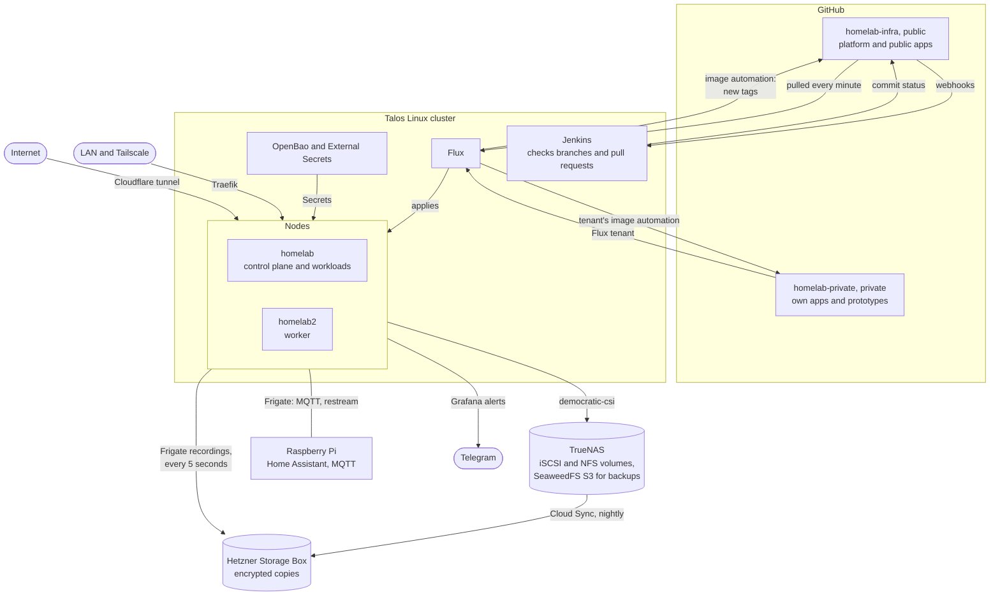
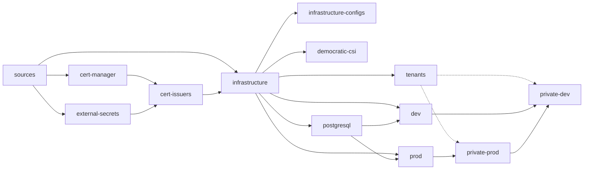
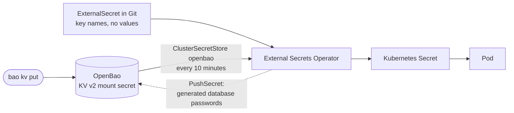
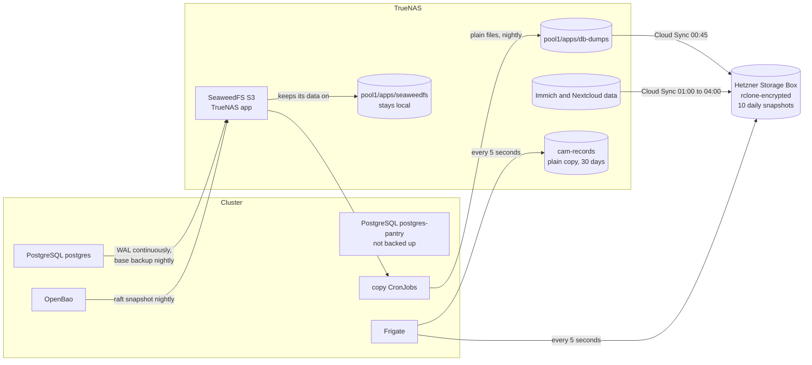

# Architecture and GitOps

What runs where, how Flux builds the homelab from this repository, how traffic
and secrets reach the apps, and how the data is backed up and recovered. Why
some of it is the way it is:
[design decisions and trade-offs](design-decisions.md).

## Overview



| Host | Role |
| --- | --- |
| `homelab` | Talos control plane, also runs workloads; Intel iGPU for transcoding and Frigate |
| `homelab2` | Talos worker |
| TrueNAS | iSCSI and NFS storage for the cluster (democratic-csi), SeaweedFS as the S3 staging area for database backups, nightly encrypted sync to a Hetzner Storage Box |
| Raspberry Pi | AdGuard Home, Home Assistant, Mosquitto (MQTT for Frigate), Vaultwarden behind Caddy (Docker Compose, managed separately) |

- **Flux** applies `clusters/homelab/` in dependency order: chart sources,
  cert-manager and External Secrets, the infrastructure, then the apps
  ([Flux](#flux)). An empty cluster converges from Git once two bootstrap
  Secrets exist ([Bootstrap](#bootstrap)).
- **Network**: Cilium carries pod traffic, encrypts it between the nodes with
  WireGuard, replaces kube-proxy and enforces the NetworkPolicies. Every
  Service is ClusterIP; traffic comes in only through Traefik on the nodes'
  LAN and Tailscale addresses, AdGuard's DNS and the Cloudflare tunnel, and
  nothing is port-forwarded ([Network](#network)).
- **Secrets** never enter Git in plain text. Each Secret is an ExternalSecret
  that reads `secret/<namespace>/<name>` from OpenBao; database passwords are
  generated by ESO and pushed to OpenBao once ([Secrets](#secrets)).
- **Volumes** are pinned: every PersistentVolume is in Git with its CSI handle,
  so a rebuilt cluster binds the same TrueNAS disks instead of empty ones
  ([AGENTS.md](../AGENTS.md#rules)).
- **Backups**: the main PostgreSQL cluster and OpenBao back up to SeaweedFS on
  TrueNAS, and every night the database backups, Immich and Nextcloud go,
  encrypted, to the Storage Box
  ([Backups and disaster recovery](#backups-and-disaster-recovery)).
- **Private apps** live in a separate repository that runs as a Flux tenant
  with its own ServiceAccount, Git source and image automation
  ([tenants.md](tenants.md)).
- **Upgrades**: Flux image automation and tuppr keep Talos and Kubernetes on the
  latest patch release; chart versions are pinned and bumped in Git
  ([Image automation](#image-automation)). Jenkins checks every branch and
  pull request ([CI](#ci)).

## Flux

Flux v2.10.0 runs from `clusters/homelab/flux-system/`. It follows `main` of
this repository and applies the Kustomizations in `clusters/homelab/`:

| Kustomization | Path | Depends on |
| --- | --- | --- |
| `sources` | `infrastructure/sources` | - |
| `cert-manager` | `infrastructure/cert-manager/controller` | `sources` |
| `external-secrets` | `infrastructure/external-secrets/controller` | `sources` |
| `cert-issuers` | `infrastructure/cert-manager/cert-issuers` | `cert-manager`, `external-secrets` |
| `infrastructure` | `infrastructure` | `sources`, `cert-issuers` |
| `infrastructure-configs` | `infrastructure/configs` | `infrastructure` |
| `democratic-csi` | `infrastructure/democratic-csi` | `infrastructure` |
| `postgresql` | `apps/base/postgresql` | `infrastructure` |
| `prod` | `apps/production` | `infrastructure`, `postgresql` |
| `dev` | `apps/dev` | `infrastructure`, `postgresql` |
| `tenants` | `tenants` | `infrastructure` |

`tenants` creates the tenants' own Kustomizations, which build their private
repositories ([tenants.md](tenants.md)).

Each arrow points to a Kustomization that waits for the one it starts from;
the dotted arrows are the tenant Kustomizations that `tenants` creates:



The Git sources are fetched every minute, and a new commit is applied as soon
as it is fetched. Every Kustomization also re-applies itself every 2 minutes, so
a change made in the cluster by hand is undone within 2 minutes.

A directory becomes active only when its parent `kustomization.yaml` lists it.
The exception is `infrastructure/configs/`, which lists component
subdirectories such as `infrastructure/traefik/tls-store/` (see below).

## CRDs from charts

Flux dry-runs a Kustomization's whole path before it applies any of it, and an
unknown kind fails that dry-run. The Traefik, kube-prometheus-stack, tuppr and
CloudNativePG HelmReleases in `infrastructure` install the `traefik.io`,
`monitoring.coreos.com`, `tuppr.home-operations.com`, `postgresql.cnpg.io` and
`barmancloud.cnpg.io` CRDs, so:

- `infrastructure` itself holds no objects of those kinds. Custom resources for
  its charts live in subdirectories that `infrastructure/configs/` lists:
  `traefik/tls-store/`, `flux-operator/web-auth/`, `goldilocks/web-auth/`,
  `tuppr/upgrades/` and `monitoring/scrape/`.
- `infrastructure` health-checks every such CRD that a later Kustomization uses
  (`clusters/homelab/infrastructure.yaml`). It turns Ready once Helm has
  installed them, and only then do the Kustomizations that depend on it start.

`tests/flux/test_cold_start.py` fails when an object of a chart CRD kind lands
in `infrastructure`, or when a later Kustomization uses a CRD that is not
health-checked. Add the CRD to the health checks when you start using a new
kind.

Moving an object to another Kustomization deletes and recreates it unless it
already carries `kustomize.toolkit.fluxcd.io/prune: disabled` in the cluster.
Push that annotation first, then the move without it; the new Kustomization's
apply removes the annotation.

## Bootstrap

The cluster keeps two Secrets in `flux-system`:

- `flux-system`: the SSH deploy key Flux reads `main` with (`identity`,
  `identity.pub`, `known_hosts`). The key is a GitHub deploy key with write
  access, because image automation pushes with it too. There is no GitHub
  token in the cluster. The trade-off: whoever can read Secrets in
  `flux-system` can push to this repository
  ([design decisions](design-decisions.md)).
- `sops-age`: the Age private key (`age.agekey`) for SOPS decryption, which only
  the democratic-csi driver configs use.

OpenBao also needs its seal key before it can serve the other Secrets: create
`openbao/openbao-seal` as in `apps/production/openbao/README.md`.

A new cluster is installed with Cilium (`infrastructure/cilium`) as its CNI
from the start.

On a new cluster, create both Secrets first, then apply the committed
bootstrap:

```sh
kubectl create namespace flux-system
ssh-keyscan github.com > known_hosts   # compare with api.github.com/meta
kubectl -n flux-system create secret generic flux-system \
  --from-file=identity=<key> --from-file=identity.pub=<key>.pub --from-file=known_hosts
kubectl -n flux-system create secret generic sops-age --from-file=age.agekey=<age key file>
kubectl apply --server-side -k clusters/homelab/flux-system
```

`flux bootstrap git --url=ssh://git@github.com/barissekerciler/homelab-infra`
also works. It regenerates the same `flux-system` files and commits them.
Flux then builds the cluster from Git in the order above; no CRDs need
applying by hand.

## Network

Cilium (`infrastructure/cilium`) is the CNI. It carries pod traffic between
the nodes over VXLAN, encrypted with WireGuard, replaces kube-proxy and
enforces the NetworkPolicies; Talos deploys neither its own CNI nor
kube-proxy. How it is set up and how to check it:
[talos/README.md](../talos/README.md#networkpolicies).

Every Service is ClusterIP: no NodePorts, LoadBalancers or externalIPs
(`tests/manifests/test_exposure.py`). Traffic comes in only through:

- **Traefik** on the nodes' LAN and Tailscale addresses (hostPorts 80 and 443,
  465 and 993 for mail), for every `*.home.bariss.dev` host and the mail
  ports. AdGuard Home resolves those names for LAN and Tailscale clients only
  ([Web UI](#web-ui)).
- **AdGuard Home** on the host network for DNS, and Frigate's restream on
  hostPort 8554 for the Pi.
- **The Cloudflare tunnel** (`infrastructure/cloudflared`) for the public
  hosts. It connects outward, so the router forwards no ports, and it answers
  404 for every `*.home.bariss.dev` name: a LAN-only host is never served to
  the internet, even when someone knows its name.

Inside the cluster, an app without a login of its own admits only its
clients: the Flux UI only Traefik, gluetun's proxy only Traefik and the
namespaces that browse through it, Redis only `media`. node-exporter runs on
the host network, so a kube-rbac-proxy in front of it answers only
Prometheus' ServiceAccount token ([Monitoring](#monitoring)). The Claude Code
namespaces have egress policies that keep them away from private data
([claude-code](../apps/production/claude-code/README.md)).

Cilium always admits traffic from a pod's own node, so a process on the node
or a host-network pod reaches any pod on that node past its NetworkPolicy
(Frigate's README lists what that exposes there).

## Web UI

`infrastructure/flux-operator/` installs the Flux Operator chart only for its
Web UI at `https://flux.home.bariss.dev`. There is no FluxInstance, so the
operator does not manage the Flux controllers above. AdGuard resolves the host
for LAN and Tailscale clients only: one wildcard per client group answers every
`*.home.bariss.dev` name with both nodes, so a new ingress host needs no DNS
change. Only the Raspberry Pi's names (Caddy) are listed in
`infrastructure/adguardhome/adguardhome-config.yaml`
(`tests/manifests/test_adguard_rules.py`).

The `flux-web-auth` Traefik middleware (`web-auth/`) sends every request to
the oauth2-proxy in `infrastructure/oauth2-proxy/home-bariss-dev/`
(forwardAuth). Only the GitHub account `barissekerciler` may sign in. The
sign-in uses a GitHub App with:

- Callback URLs `https://flux.home.bariss.dev/oauth2/callback`,
  `https://cam.home.bariss.dev/oauth2/callback` (Frigate, `apps/production/frigate`),
  `https://agent-browser.home.bariss.dev/oauth2/callback` (the Claude box's
  browser, `apps/production/claude-agents`),
  `https://goldilocks.home.bariss.dev/oauth2/callback` (`infrastructure/goldilocks`) and
  `https://openbao.home.bariss.dev/oauth2/callback` (`apps/production/openbao`)
- Webhook off, account permission "Email addresses: Read-only", no install needed

Its client ID and secret live in `oauth2-proxy-secret` in that directory:

```sh
bao kv patch secret/oauth2-proxy-home-bariss-dev/oauth2-proxy-secret client-id=<client id> client-secret=<client secret>
```

To protect another `*.home.bariss.dev` host, add it to that release's
`ingress.hosts`, add its `/oauth2/callback` URL to the GitHub App and put a
forwardAuth middleware like `flux-web-auth` on its route. The session cookie
covers `.home.bariss.dev`.

Behind that sign-in the UI acts as group `flux-web-admins`, bound to the chart's
`flux-web-admin` role: view everything, reconcile, suspend, resume and restart.
The chart's own NetworkPolicy admits every namespace, so it is off; the
`flux-operator-web` NetworkPolicy in `infrastructure/flux-operator/` admits
only Traefik, and no pod can reach the UI past the sign-in.

## Secrets

Secret values live in OpenBao (`apps/production/openbao`), KV v2 mount `secret`,
key `<namespace>/<secret name>`. Git holds an ExternalSecret per Secret that names
its keys; the External Secrets Operator (`infrastructure/external-secrets`) reads
them through the ClusterSecretStore `openbao` and refreshes every 10 minutes.
The store serves every namespace except `claude-agents` and `claude-code`, so
the Claude Code box cannot read OpenBao through an ExternalSecret of its own.



A config file with a secret in it is a ConfigMap template that an ExternalSecret
renders into a Secret (`infrastructure/adguardhome`). Values that are not
secret but should not be public (account names, contact addresses, Tailscale
addresses) take the same path: an ExternalSecret key read as an environment
variable or a template value, or, for the ClusterIssuers' ACME email, Flux
`postBuild` substitution from the Secret `flux-system/acme-account`
(`clusters/homelab/certs.yaml`). Only the democratic-csi
driver configs stay SOPS-encrypted (OpenBao's iSCSI volume needs them first), and
only the `democratic-csi` Kustomization decrypts.

## Helm

Each Helm application keeps a `release.yaml` HelmRelease beside its other
resources. Chart sources live in `infrastructure/sources/`. Charts are pinned
to exact versions, and values stay inline in the HelmRelease.

The democratic-csi driver config Secrets carry `helm.sh/resource-policy: keep`.
Older Helm revisions rendered them from values, so an upgrade would otherwise
delete them.

## Monitoring

`infrastructure/monitoring/` runs two HelmReleases in the `monitoring` namespace:

- `kube-prometheus-stack`: Prometheus (35 days, at most 27 GB, on a 30 Gi
  iSCSI volume, so 30-day queries always have a full window), the operator,
  kube-state-metrics and node-exporter. Alertmanager is off: Grafana Alerting
  sends the notifications, Prometheus' own alerts included (`alerting/`).
  Talos binds the controller
  manager, scheduler and etcd metrics to localhost, so their scrapes are off.
  Prometheus picks up ServiceMonitors, PodMonitors and rules from every
  namespace; its config-reloader loads rule changes, and Reloader leaves it
  out (`reloader.stakater.com/auto: "false"`), since a restart would take it
  away for a minute on every PrometheusRule change. node-exporter listens on the nodes' addresses, so a
  kube-rbac-proxy in front of it serves the metrics over HTTPS only to
  Prometheus' ServiceAccount token (`node-exporter-rbac.yaml`).
- `grafana`: Grafana at `https://grafana.home.bariss.dev` (LAN and Tailscale)
  with its own login; the admin login is in the Secret `grafana-admin` (OpenBao).
  Its sidecars load the Prometheus datasource and the Kubernetes dashboards
  (folder `Kubernetes`) from the ConfigMaps kube-prometheus-stack renders.
  Grafana has no volume, on purpose: its datasources, dashboards and alerting
  come from Git on every start, so it holds no state worth keeping. Logins,
  anything saved in the UI, silences and the alerts' state are lost on
  restart, so an alert that is firing then sends once more.
- `dashboards/`: the `Homelab` dashboard (folder `Homelab`) as JSON in a
  generated ConfigMap. It shows health, used vs reserved capacity per node,
  temperatures, top pods, Flux readiness, Traefik traffic and volume usage.
  Prometheus scrapes flux-operator, Traefik and cert-manager for it
  (`additionalPodMonitors`). `homelab.py` generates the JSON; edit the script
  and run it, a test checks the two match.
- `alerting/`: Grafana Alerting, loaded by Grafana's alert sidecar from the
  `grafana-alerting` ConfigMap and shown read-only. Notifications go to a
  Telegram chat through a bot; the token and chat id are in the Secret
  `grafana-telegram` (OpenBao `secret/monitoring/grafana-telegram`, keys
  `bot-token` and `chat-id`). Critical alerts ring and repeat every 4 hours,
  warnings arrive silently and repeat daily, and a resolved alert sends ✅.
  The rules (`alerts.py` generates `rules.json`; a test checks the two match)
  are:
  - `Prometheus alert` forwards Prometheus' own alerts (kube-prometheus-stack's
    rules) from its `ALERTS` series: every critical one, and the warnings
    except those in `jenkins`, `claude-agents` and the `-dev` namespaces and
    the node saturation warnings, which fire under normal load. The message
    names the alert and where it fired; the rule's text is in Grafana's alert
    list.
  - NAS: TrueNAS unreachable, a ZFS pool not online, pool1 below 1.5 TB free
    (critical below 750 GB), a disk at 50 °C (critical at 55 °C).
  - Backups: PostgreSQL's last base backup or a nightly backup job
    (`openbao-snapshot`, `openbao-snapshot-copy`, `postgresql-backup-copy`)
    older than 26 hours, or its metric missing. The Cloud Sync to Hetzner runs
    on TrueNAS and is not watched here; TrueNAS mails its own failures.
  - A Flux Kustomization, HelmRelease or GitRepository not ready for 15
    minutes, and a certificate within 14 days of expiry.
  - `Prometheus unreachable`: Grafana's queries fail. The other rules then
    keep their last state.

  Grafana itself going down sends nothing. Tenants add rules as labelled
  ConfigMaps in `monitoring` with file names of their own, never a policies
  file (there is one policy tree).
- `scrape/`: ScrapeConfigs for targets outside the cluster, applied by
  `infrastructure-configs`. `truenas` reads node-exporter on the NAS
  (`truenas/apps/node-exporter`, a TrueNAS Custom App) with temperatures, ZFS
  pool state, free space and the read caches (ARC in RAM, L2ARC on an SSD).
  Its udev data names the disks by SATA port on the dashboard. Tenants add
  their own targets and dashboards (ScrapeConfigs and labelled ConfigMaps in
  `monitoring`) from their repositories.

## Image automation

`infrastructure/image-update-automation/` contains:

- `sources.yaml`: Redlib's fork (`ghcr.io/nachtalb/redlib`), scanned hourly, and
  the Talos and kubelet images, scanned twice a day
- `policies/`: `redlib` follows `latest` and reflects its digest, because the
  fork's `sha-<commit>` tags do not sort by age, so `apps/production/redlib`
  pins `latest@sha256:...`; `talos` and `kubelet` pick the newest patch release
- `image-update-automation.yaml`: writes `$imagepolicy` markers under `apps/`
  and pushes to `main`
- `tuppr-update-automation.yaml`: writes the `talos` and `kubelet` policies' newest
  patch tags (Talos `~1.14`, Kubernetes `~1.36`) into `infrastructure/tuppr/upgrades`;
  tuppr upgrades the nodes in its night window (`talos/README.md`)

Tenants run their own image automation in their namespace and push to their own
repository.

## CI

Jenkins checks every branch of this repository and every pull request opened
from one: the `homelab-infra` job (defined with Job DSL in
`apps/production/jenkins/jcasc.yaml`) runs the `Jenkinsfile`, which builds and
validates every overlay (`scripts/validate.sh`), runs the tests and renders
every Kustomization and HelmRelease with
[flate](https://github.com/home-operations/flate), so a chart whose templates
or values break with these values fails. On a pull request the log also shows
the rendered diff. The result goes back to GitHub as a commit status. Pull
requests from forks are never built: the repository is public, and a fork's
Jenkinsfile would run in the cluster. The pod has no ServiceAccount token.

## Backups and disaster recovery

The cluster's state is in Git, and its data is on TrueNAS: every app volume is
an iSCSI or NFS volume pinned in Git ([AGENTS.md](../AGENTS.md#rules)), so a
rebuilt cluster binds the same disks. What needs backing up is the data, and
it leaves the house every night:



- **SeaweedFS is a staging area, not the backup.** It exists because
  CloudNativePG's Barman Cloud plugin and OpenBao's snapshot agent write to
  S3, and it runs as a TrueNAS app outside the cluster, so it survives the
  loss of the cluster. Every night the CronJobs `postgresql-backup-copy` and
  `openbao-snapshot-copy` copy the backups out of it as plain files into
  `pool1/apps/db-dumps`, and TrueNAS Cloud Sync uploads that dataset,
  encrypted, to the Storage Box. The copies only add files and drop them by
  age, and only while recent backups arrive, so a new or emptied bucket never
  empties the offsite copy
  ([PostgreSQL](../apps/production/postgresql/README.md#backups),
  [OpenBao](../apps/production/openbao/README.md),
  [SeaweedFS](../truenas/apps/seaweedfs/README.md)).
- **Only database backups go offsite through SeaweedFS.** Its own dataset has
  no Cloud Sync task, so a bucket added later for other backups stays on the
  NAS. OpenBao's raft snapshots count as database backups: the raft store is
  OpenBao's database, and without an offsite copy a lost house would lose
  every secret.
- **Only data worth keeping is backed up.** The main PostgreSQL cluster
  `postgres`, OpenBao, Immich, Nextcloud and Frigate are; the
  `postgres-pantry` cluster holds expendable data and is not.
- **The Storage Box keeps 10 daily snapshots**, so a sync that copies a
  deletion or a broken file can be undone.

How much can be lost: `postgres` archives WAL continuously, so on site it loses
at most the last few minutes and offsite the time since the last nightly copy.
OpenBao, Immich and Nextcloud lose at most a day. `postgres-pantry` loses
everything, by design.

| What fails | What happens | Recovery |
| --- | --- | --- |
| `homelab2` | The API keeps working. Its pods move to `homelab` (nothing is pinned to a node); iSCSI volumes follow once Kubernetes gives up on the lost node. | Nothing needed; bring the node back. |
| `homelab` | It is the only control plane: pods on `homelab2` keep running, but nothing is scheduled, restarted or applied until it is back. | Repair or reinstall it with `talos/`. |
| The whole cluster | The volumes, SeaweedFS and the copies are on TrueNAS; at most PostgreSQL's last few minutes are lost. | Install Talos, create the [bootstrap](#bootstrap) Secrets and OpenBao's seal key; Flux rebuilds everything from Git, pinned volumes bind their old disks, and PostgreSQL restores from its Barman Cloud backups. |
| TrueNAS | All volumes and the on-site backups. | Restore from the Storage Box: PostgreSQL and OpenBao from `db-dumps`, Immich and Nextcloud from their own copies. |
| The house | Everything on site. | Start over from Git and the Storage Box. That needs the keys kept outside the house: OpenBao's seal key and the Cloud Sync encryption password and salt. |
